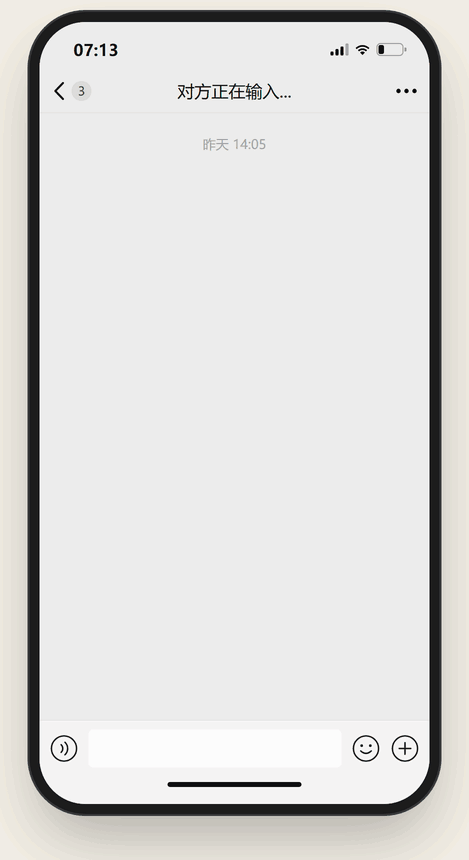
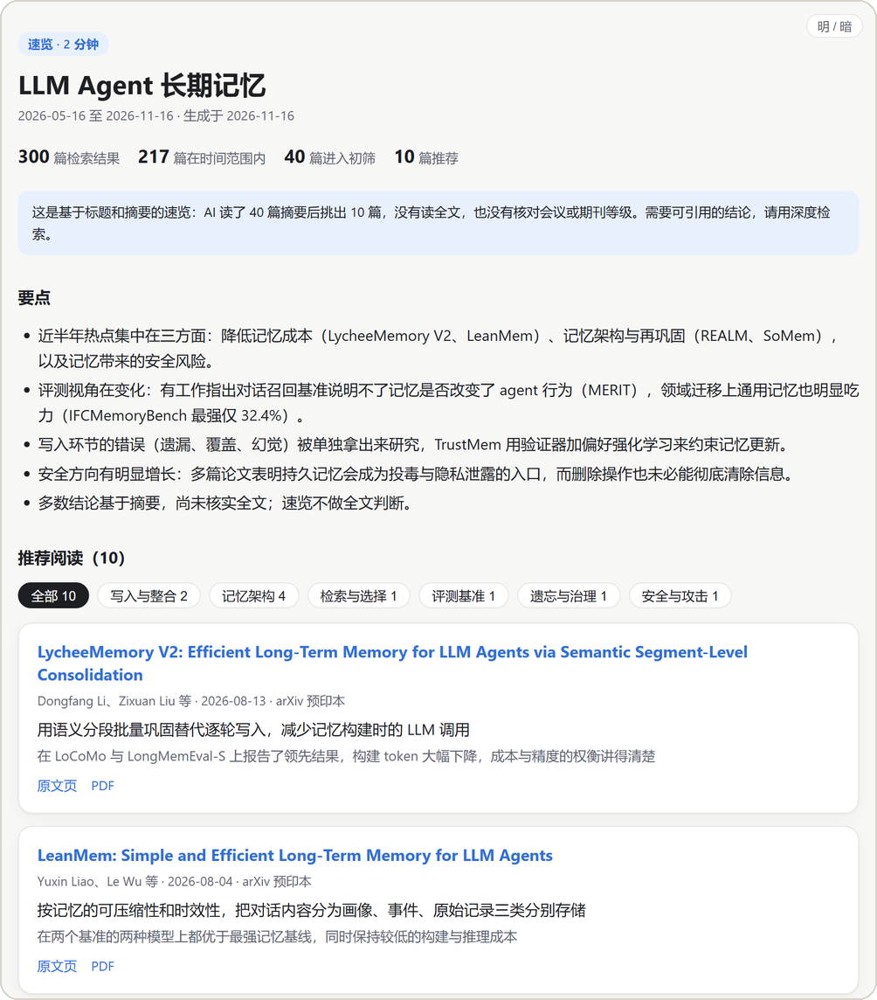
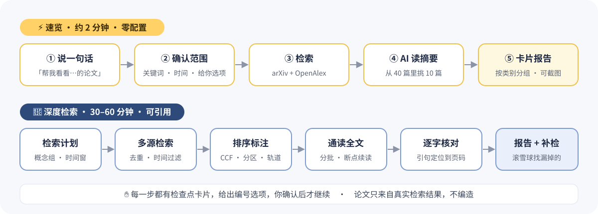
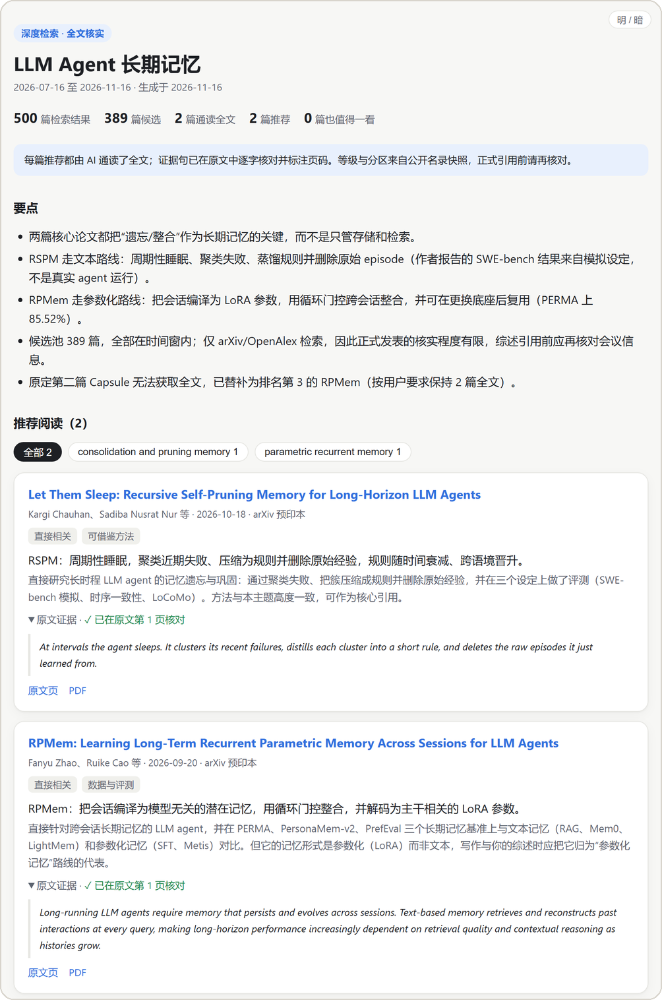

<div align="center">


**简体中文** · [English](README_EN.md)


**跟论文喵说一句「帮我看看 XX 最近有什么论文」，两分钟后拿到一页好看的论文速递。**<br>
要写综述、要能引用？一键升级成深度检索：通读全文，每条结论都附原文原句和页码。

</div>

---

## 😿 故事要从导师的一条微信说起

<div align="center">

<br><sub>（根据真实心理阴影改编。如有雷同，说明你也经历过）</sub>
</div>

导师：「下周组会你讲一下“大模型自进化”，先找几篇代表性论文发我看看。」

我熬到 23:48，**精挑细选**了 4 篇：

| # | 我发的“论文” | 导师的点评 |
|---|---|---|
| 1 | 📱 小红书笔记《震惊！大模型竟学会自我进化，网友：细思极恐》 | “细思极恐——我确实细思极恐，恐的是你下周的组会。” |
| 2 | 📰 滨江晚报 · 第 7 版 | “上一版是今日菜价，下一版是寻狗启事。” |
| 3 | 📜 1983 年的扫描版（第 3 页缺失） | “比我还大一岁。论文也是要退休的，你就让它安享晚年吧。” |
| 4 | 🏆 《国际超前沿高端先进科学技术学报》 | “名字越长越高端是吧？三天录用，版面费还能议价。这不叫期刊，这叫菜市场。” |

导师总结：**“这几篇的深度，刚好没过脚背。”** 外加一句：“别再发震惊体了，我的血压也是会自进化的。”

我：*已老实，求放过。* 🙇

痛定思痛，我把导师的要求一条一条写成了代码，这就是**论文喵**：

| 导师的要求 | 论文喵怎么做到 |
|---|---|
| ✅ 顶会顶刊 | CCF 等级、中科院分区一律查公开名录；Findings / Workshop 不冒充主会；期刊名字再长，名录里没有就不给等级 |
| ✅ 近两年 | 按时间窗严格过滤；只知道年份的论文会标“可能在范围外”，不蒙混过关 |
| ✅ 有深度 | 深度模式下载并通读全文，每条结论附原文原句和页码，逐字核对 |
| ✅ 方向对口 | 按概念组检索、逐篇判断相关性，摘要里出现你的排除词会提醒你 |
| ❌ 震惊体 | 小红书只当线索：必须在 arXiv / OpenAlex 查到真论文，才能进入候选 |
| ❌ 晚报第 7 版 | 只查学术数据库（arXiv、OpenAlex、Crossref……），报纸进不来 |

> 现在我的组会论文清单两分钟就能出，导师的血压也稳住了。<br>
> 至于那两百块报销……论文喵暂时还帮不上忙。

---

## ⚡ 两分钟零配置上手

> 不需要注册账号，不需要 API key，不需要改任何配置文件。有 Python 3.9+ 就能用。

**① 安装**：下载本仓库（或 release 里的 `paper-cat-<版本>.zip`）并解压，在解压出的文件夹里运行：

```bash
python scripts/install_skill.py --target claude     # Claude Code；Codex 用 --target codex
python scripts/doctor.py                            # 1 秒自检：告诉你现在能用什么
```

> 也可以把文件夹复制到 `~/.claude/skills/paper-cat`（Codex 是 `~/.codex/skills/paper-cat`），注意文件夹名要叫 `paper-cat`。Windows 上 `python` 不可用时换成 `py`。

**② 对 Agent 说一句话**

> 论文喵，帮我看看「LLM Agent 长期记忆」最近半年有什么值得读的论文

**③ 两分钟后看报告**：Agent 先用带编号的选项跟你确认关键词和时间范围，然后检索 arXiv 和 OpenAlex，读完几十篇摘要，挑出最值得看的 10 篇，生成一页卡片式报告。每篇都用一句话讲清做了什么、为什么值得看，按方法类别分组，可以直接截图分享。

<div align="center">

<br><sub>真实运行截图：速览报告（基于摘要，明确标注“未读全文”）</sub>
</div>

**还可以这样说：**

- 「帮我快速看看扩散模型做视频生成最近三个月的论文」
- 「我在写综述，对『蛋白质结构预测』做一次深度检索，要能引用的」
- 「ICLR 2026 里和 Agent 记忆相关的论文帮我找全」
- 「小红书上最近在推的这几篇论文（附帖子）靠谱吗？」

---

## 🔀 两种模式，按需选择

<div align="center">

</div>

| | ⚡ 速览（默认） | 🔬 深度检索 |
|---|---|---|
| 怎么触发 | 直接问 | 说「深度检索 / 写综述 / 要能引用 / 找全」 |
| 用时 | 约 2 分钟 | 约 30–60 分钟（看阅读量） |
| AI 读什么 | 标题和摘要 | **下载并通读全文** |
| 结论能否引用 | 适合摸底，页面明确标注“基于摘要” | 每条结论附原文原句 + 页码，导入时逐字核对 |
| 额外内容 | — | CCF 等级、中科院分区、会议主会 / Findings 轨道、滚雪球补检、小红书口碑 |
| 需要配置 | 无 | 无（`pip install pymupdf` 用于抽取 PDF 文本） |

---

## 🔬 深度检索：每条结论都有原文证据

<div align="center">

<br><sub>真实运行截图：深度检索报告，展开的“原文证据”已在 PDF 原文中逐字核对</sub>
</div>

- **全文通读**：自动下载开放获取 PDF、按页抽取文本、分批阅读；中断后只重读没读完的批次。
- **引句逐字核对**：AI 写的每条证据都必须能在原文中找到，并定位到页码，改写或编造会被直接拒收。
- **等级只查表**：CCF 等级、中科院分区来自公开名录；Findings / Workshop 不冒充主会；预印本自称“已录用”只标为“自称”。
- **滚雪球补检**：从已读论文的参考文献里找出检索漏掉的论文，你挑编号补读。
- **每步都有检查点**：检索计划、候选池、阅读名单……每一步都给你一张卡片和编号选项，确认后才继续。拿不到全文的论文，可以手动放入 PDF，或用名单后面的论文替补。

---

## 🛡️ 为什么可信

- **不编论文**：每篇论文都来自真实检索结果；Agent 只能从候选名单里挑，名单外的 id 会被拒绝。
- **不冒充核实**：速览页面写明“基于摘要”；深度模式没有拿到全文的论文保持“待核实”，不会进入核心结论。
- **相关性和名气分开**：分数、等级、小红书热度都不能当作“相关”的理由；“没有合格论文”也是有效结论，不凑数。
- **可复现**：检索式、数据源、每篇候选的取舍原因，都在报告底部的折叠区。
- **隐私**：密钥只在你自己的终端里输入，不会出现在对话中；小红书只读，服务只监听本机。

---

## 🔓 想要更全？按需解锁

随时运行 `python scripts/doctor.py`，看现在能用什么、还能解锁什么。**以下全部可选，不配也能完整使用。**

| 增强 | 你需要做的 | 你会得到 |
|---|---|---|
| OpenAlex key | 免费注册，1 分钟：`python scripts/configure_env.py openalex` | 不配也能用；配了有自己的每日额度，不易被限流 |
| Semantic Scholar key | 填表申请：`python scripts/configure_env.py semantic` | 多一个高质量检索源 |
| Unpaywall | 只填一个联系邮箱：`python scripts/configure_env.py unpaywall` | 多一个合法开放获取 PDF 渠道 |
| 小红书 | `python scripts/xhs_setup.py --setup`，扫码登录（或直接把帖子贴给 Agent） | 发现大家在讨论的论文，给推荐论文附上社区口碑（仅作参考） |
| 本地排序模型 | 见 [`references/runtime-setup.md`](references/runtime-setup.md) | 候选上千篇时排序更快 |

---

## 🧭 学科包

| 包 | 适用 | 特点 |
|---|---|---|
| `general`（默认） | 所有学科 | arXiv、OpenAlex、Crossref；中科院期刊分区 |
| `cs` | 计算机 | 加 DBLP、CCF 等级、会议轨道规则（主会 / Findings / Workshop） |

医学（PubMed / medRxiv）、社科（SSRN / CSSCI）等学科包在规划中，格式见 [`packs/`](packs/)。

---

## 💻 适配的 Agent 与系统

Claude Code、Codex，以及其他读取 `SKILL.md` 的 Agent（`install_skill.py --target <skills 目录>`）；Windows、macOS、Linux。脚本只依赖 Python 标准库（Python 3.9 起实测可用）；深度模式抽取 PDF 文本建议 `pip install pymupdf`。

<p align="center"></p>

> **关于三平台的小小坦白 😅**<br>
> 因为作者受到**物理**（手边只有一台 Windows）和**经济**（钱包里飞出了一只蛾子）的双重限制，目前完整流程只在 Windows 上实测过。macOS 和 Linux 已经做了理论上的适配（路径、编码、进程管理都按跨平台写的），按理说应该没什么问题～<br>
> 如果你在 Mac 或 Linux 上跑通了，或者不幸翻车了，都欢迎告诉作者，你就是这个项目的第一位跨平台测试官 🎖️

---

## 📁 目录

```
SKILL.md                 Agent 的工作说明（交互流程、硬规则）
scripts/quick.py         两分钟速览
scripts/run.py           深度检索（init → search → rank → fetch → finalize）
scripts/reading.py       分批通读、断点续读、引句核对
scripts/snowball.py      从参考文献补检
scripts/clue_import.py   小红书线索与口碑
scripts/doctor.py        环境自检与可选增强
packs/                   学科包
references/              详细说明（运行环境、阅读协议、数据源）
tests/                   自动化测试
assets/                  README 用的图片
```

## 🧪 测试

```bash
python -X utf8 -B -m unittest discover -s tests -p "test_*.py"
```
