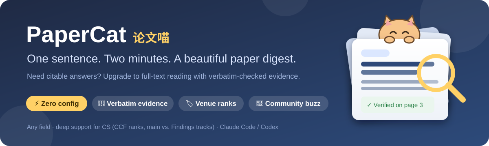
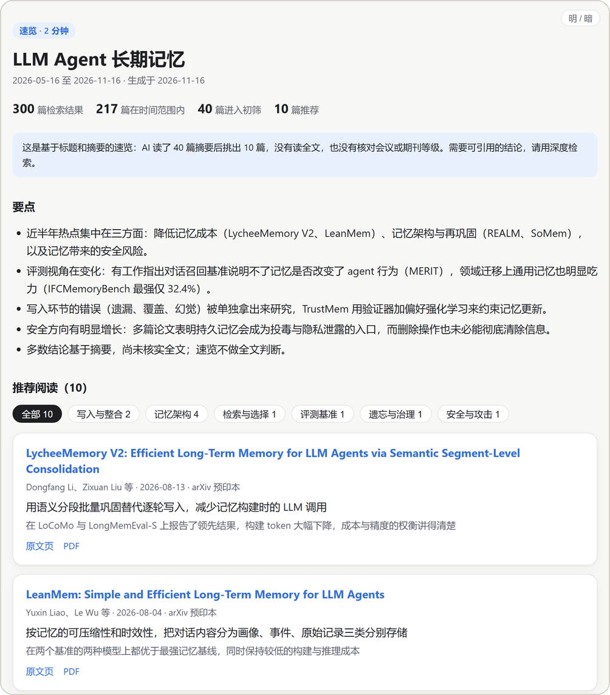
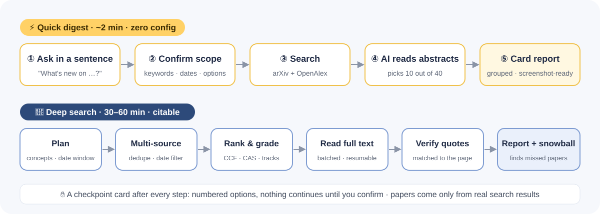
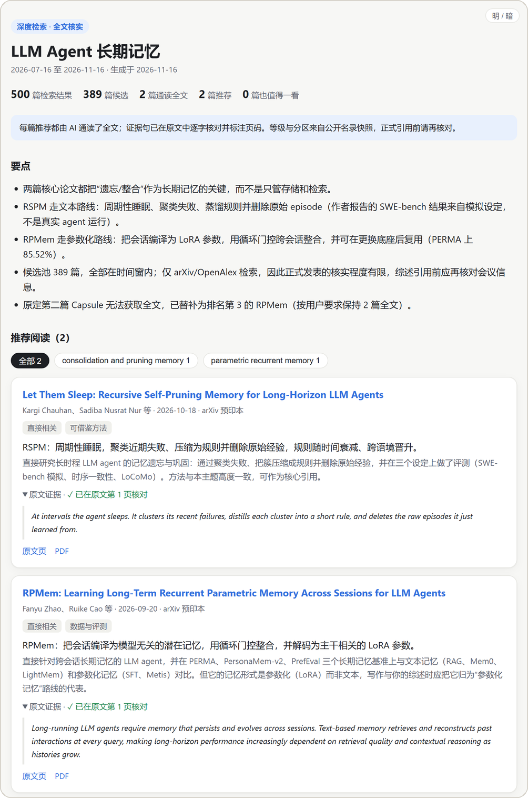

<div align="center">



[简体中文](README.md) · **English**


**Ask PaperCat "what's new on X lately?" and get a beautiful one-page paper digest two minutes later.**<br>
Writing a survey and need citable answers? Upgrade to deep search: the agent reads the full papers, and every claim comes with a verbatim quote and page number.

</div>

---

## 😿 How it started: one WeChat message from my advisor

<div align="center">

<br><sub>(Based on real emotional damage. The chat is in Chinese; the gist is below.)</sub>
</div>

My advisor: *"Present 'self-evolving LLMs' at next week's group meeting. Send me a few representative papers first."*

At 23:48 I proudly sent four **hand-picked** papers:

| # | What I sent | What my advisor said |
|---|---|---|
| 1 | 📱 A viral post: "SHOCKING! LLMs learn to evolve themselves, netizens terrified" | "Terrified indeed: of your group meeting next week." |
| 2 | 📰 Page 7 of a local evening newspaper | "The page before is today's vegetable prices. The page after is a lost-dog notice." |
| 3 | 📜 A scan from 1983, page 3 missing | "It's a year older than me. Papers deserve to retire too." |
| 4 | 🏆 *International Journal of Ultra-Frontier Advanced High-End Science and Technology* | "The longer the name, the fancier, right? Accepted in three days, negotiable fees. That's not a journal, that's a vegetable market." |

The verdict: **"The depth of these papers barely covers your ankles."** Plus: *"No more clickbait. My blood pressure can self-evolve too."*

Me: *kneels, cries, starts typing furiously.* 🙇

So I turned every one of my advisor's demands into code. That's **PaperCat**:

| My advisor wants | How PaperCat does it |
|---|---|
| ✅ Top venues | CCF ranks and CAS partitions come only from public lists; Findings / workshops never pass as the main conference; a long journal name earns no rank |
| ✅ Recent work | Strict date windows; papers known only by year are flagged "may be outside the range" |
| ✅ Real depth | Deep mode downloads and reads the full text; every claim carries a verbatim quote and page number |
| ✅ On topic | Concept-group search, per-paper relevance judgments, and a warning when your exclusion terms show up |
| ❌ Clickbait | Social posts are only leads: a paper enters the pool only after it is found on arXiv / OpenAlex |
| ❌ Evening papers | Only scholarly databases (arXiv, OpenAlex, Crossref …); newspapers can't get in |

> Now my reading list takes two minutes and my advisor's blood pressure is stable.<br>
> The 200 yuan my advisor still owes me in reimbursements? PaperCat can't help with that. Yet.

---

## ⚡ Zero-config start in two minutes

> No account, no API key, no config file to edit. If you have Python 3.9+, you're ready.

**① Install.** `git clone https://github.com/Kristy-Nora/paper-cat` (or download `paper-cat-<version>.zip` from a release and unzip it), then run inside the folder:

```bash
python scripts/install_skill.py --target claude     # Claude Code; use --target codex for Codex
python scripts/doctor.py                            # 1-second self-check: what works right now
```

> You can also copy the folder to `~/.claude/skills/paper-cat` (or `~/.codex/skills/paper-cat`); the folder must be named `paper-cat`. On Windows, use `py` if `python` is not available.

**② Ask your agent in one sentence**

> PaperCat, show me the papers worth reading on "long-term memory for LLM agents" from the last six months

**③ Read the report two minutes later.** The agent first confirms keywords and the date range with numbered options, then searches arXiv and OpenAlex, reads dozens of abstracts, picks the 10 most worthwhile papers and builds a one-page card report. Each paper gets one sentence on what it does and one on why it's worth reading, grouped by method, ready to screenshot and share.

<div align="center">

<br><sub>A real run: the quick digest (based on abstracts and clearly labelled as such). The agent writes in your language.</sub>
</div>

**More things you can say:**

- "Quickly show me recent papers on video generation with diffusion models from the last three months"
- "I'm writing a survey: run a deep search on protein structure prediction, with citable evidence"
- "Find every ICLR 2026 paper about agent memory"
- "Are these papers people are hyping on Xiaohongshu any good? (post attached)"

---

## 🔀 Two modes, pick what you need

<div align="center">

</div>

| | ⚡ Quick digest (default) | 🔬 Deep search |
|---|---|---|
| How to start | Just ask | Say "deep search", "survey", "citable" or "find them all" |
| Time | ~2 minutes | ~30–60 minutes (depends on how many papers are read) |
| What the AI reads | Titles and abstracts | **Downloads and reads the full text** |
| Can you cite it? | Good for scouting; the page says "based on abstracts" | Every claim has a verbatim quote + page, checked word for word on import |
| Extras | — | CCF ranks, CAS journal partitions, main vs. Findings tracks, snowball search, Xiaohongshu buzz |
| Setup | None | None (`pip install pymupdf` for PDF text extraction) |

---

## 🔬 Deep search: evidence for every claim

<div align="center">

<br><sub>A real run: the deep search report. Each expanded "原文证据" (evidence) quote was matched word for word in the PDF.</sub>
</div>

- **Full-text reading.** Open-access PDFs are downloaded, extracted page by page and read in batches; after an interruption only the unfinished batches are read again.
- **Verbatim quote checks.** Every piece of evidence must be found in the original text and located to a page. Paraphrased or invented quotes are rejected.
- **Ranks come only from tables.** CCF ranks and CAS partitions come from public lists; Findings and workshops never pass as the main conference; "Accepted at X" in an arXiv comment is labelled as claimed.
- **Snowball search.** Finds papers your search missed in the reference lists of the papers already read; you pick which to add.
- **A checkpoint at every step.** Search plan, candidate pool, reading list: each step ends with a card and numbered options, and nothing continues until you confirm. If a paper's full text can't be fetched, drop in your own PDF or swap in the next paper on the list.

---

## 🛡️ Why you can trust it

- **No invented papers.** Every paper comes from real search results; the agent can only pick from the shortlist, and ids outside it are rejected.
- **No fake verification.** The quick page says "based on abstracts"; in deep mode, papers without full text stay "to be verified" and never enter the core findings.
- **Relevance is not fame.** Scores, ranks and social-media buzz are never reasons for relevance; "no qualifying papers" is a valid answer, nothing is padded.
- **Reproducible.** Queries, sources and the reason behind every candidate's decision are in a collapsible section at the bottom of the report.
- **Private.** Keys are typed only in your own terminal and never appear in the chat; Xiaohongshu access is read-only and the service listens on localhost only.

---

## 🔓 Want more? Unlock as you go

Run `python scripts/doctor.py` any time to see what works and what you could add. **Everything below is optional; the skill works fully without it.**

| Upgrade | What you do | What you get |
|---|---|---|
| OpenAlex key | Free sign-up, 1 minute: `python scripts/configure_env.py openalex` | Works without a key; with one you get your own daily quota and fewer rate limits |
| Semantic Scholar key | Apply via form: `python scripts/configure_env.py semantic` | One more high-quality search source |
| Unpaywall | Just a contact email: `python scripts/configure_env.py unpaywall` | One more legal open-access PDF channel |
| Xiaohongshu | `python scripts/xhs_setup.py --setup` and scan the QR code (or paste posts to the agent) | Discover papers people are discussing; community buzz on recommended papers (for reference only) |
| Local ranking model | See [`references/runtime-setup.md`](references/runtime-setup.md) | Faster ranking when there are thousands of candidates |

---

## 🧭 Discipline packs

| Pack | For | Adds |
|---|---|---|
| `general` (default) | Any field | arXiv, OpenAlex, Crossref; CAS journal partitions |
| `cs` | Computer science | DBLP, CCF ranks, conference track rules (main / Findings / workshop) |

Packs for medicine (PubMed / medRxiv) and social sciences (SSRN / CSSCI) are planned; see [`packs/`](packs/) for the format.

---

## 💻 Agents and platforms

Claude Code, Codex, Huawei Cloud CodeArts (`install_skill.py --target .codeartsdoer/skills`) and any other agent that reads `SKILL.md` (`install_skill.py --target <skills folder>`); the same Skill follows the open Agent Skills format and can be published to the Xiaohongshu Skill marketplace for agents to call. Windows, macOS, Linux. The scripts use only the Python standard library (verified on Python 3.9+); `pip install pymupdf` is recommended for PDF text in deep mode.

<p align="center"></p>

> **A small confession about platforms 😅**<br>
> Limited both **physically** (the author owns exactly one Windows machine) and **financially** (a moth just flew out of the wallet), the full workflow has so far been tested end to end on Windows only. macOS and Linux are supported in theory (paths, encodings and process handling are all written to be cross-platform), so they should be fine～<br>
> If you get it running on a Mac or Linux box, or it blows up on you, please tell the author: you'd be this project's first cross-platform tester 🎖️

---

## 📁 Layout

```
SKILL.md                 Instructions for the agent (interaction flow, hard rules)
scripts/quick.py         Two-minute quick digest
scripts/run.py           Deep search (init → search → rank → fetch → finalize)
scripts/reading.py       Batched full-text reading, resume, quote checks
scripts/snowball.py      Snowball search through references
scripts/clue_import.py   Xiaohongshu clues and community buzz
scripts/doctor.py        Self-check and optional upgrades
packs/                   Discipline packs
references/              Details (runtime setup, reading protocol, sources)
tests/                   Automated tests
assets/                  Images for the README
```

## 🧪 Tests

```bash
python -X utf8 -B -m unittest discover -s tests -p "test_*.py"
```
